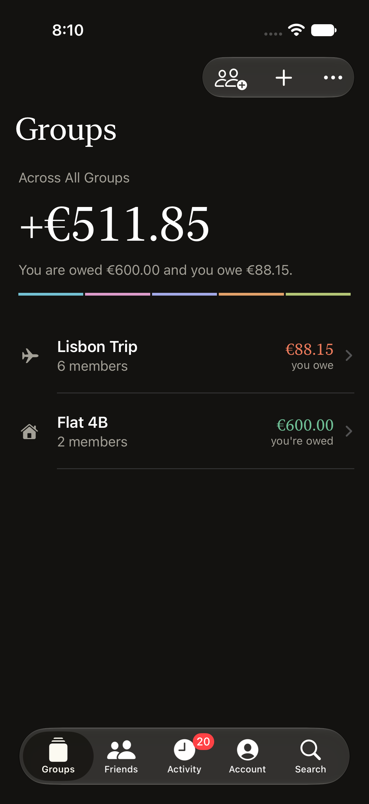
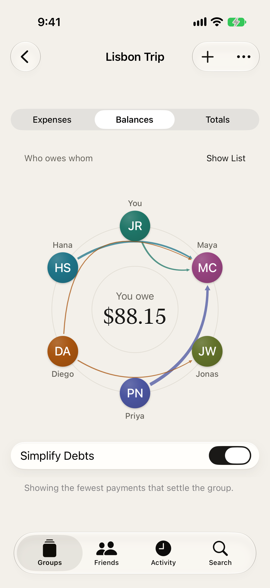
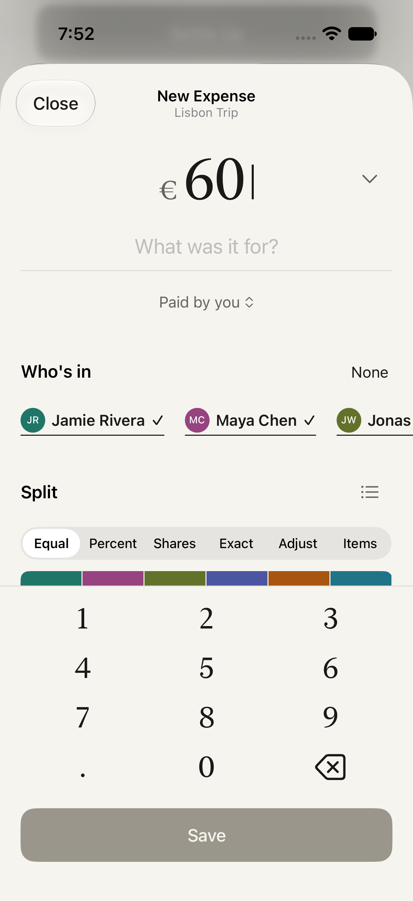
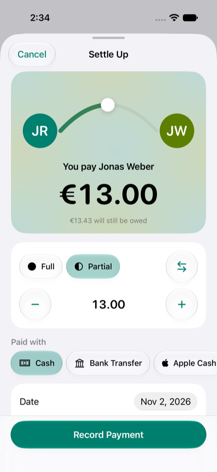

# Splt

[](https://github.com/harrypakhale98/Splt/actions/workflows/ci.yml)

Split costs with friends and groups on iPhone.

Splt is free forever. No ads, no accounts, no limits and no subscription. Your Apple ID is your identity, groups sync through your own iCloud, and the smart features (quick entry, receipt scanning, voice) run on the device. There is no Splt server.

It is built with SwiftUI and Apple frameworks only, with no third party packages.

<table>
  <tr>
    <td></td>
    <td></td>
    <td></td>
    <td></td>
  </tr>
  <tr>
    <td align="center">Groups</td>
    <td align="center">Balance orbit</td>
    <td align="center">Split bar</td>
    <td align="center">Settle up</td>
  </tr>
</table>

## What it does

- Groups and one to one balances with friends, with debts simplified to the fewest payments.
- Six ways to split: equally, exact amounts, percentages, shares, adjustments and by item.
- A balance orbit that draws who owes whom, and a split bar you drag to set the shares.
- Any currency per expense, with reference rates when you are online or a rate you pin for the group.
- Recurring expenses.
- Quick add from a sentence such as "dinner 60 with Sam and Priya", by typing or by voice.
- Receipt scanning with the document camera, then split by item.
- Settle up, in full or in part, with a note of how you paid and a shortcut into your payment app. Splt never moves money.
- Gentle reminders for friends who owe you, as local notifications you turn on yourself.
- Comments on expenses, with system translation.
- An activity feed, search in plain language, Spotlight, Siri and Shortcuts.
- Invite people with a link or a QR code.
- Export a group as a spreadsheet (CSV), PDF or JSON.
- Totals, charts and a story style trip recap of up to six pages for each group.

When the on-device language model is not available, quick add and category suggestions fall back to simple rules.

## Design

- Every person has one color that follows them across groups, balances, splits and recaps. Text on a color picks black or white for contrast.
- The balance orbit puts people on a ring with ribbons for payments. Tap a person to see only their payments.
- The split bar shows each share as a block in that person's color. Drag a divider, or tap a person to fine tune.
- Settling up draws an arc between two people and closes a ring when you are square. A short haptic marks it, and you can turn haptics off in Settings.
- It works in light and dark, with Dynamic Type up to the largest accessibility sizes, VoiceOver labels and Reduce Motion.

## Requirements

- Xcode 26 or later
- iOS 26 or later (iPhone)
- [XcodeGen](https://github.com/yonaskolb/XcodeGen), only if you change `project.yml`

## Build

```sh
git clone https://github.com/harrypakhale98/Splt.git
cd Splt
open Splt.xcodeproj
```

Pick the Splt scheme and an iPhone simulator, then run. The simulator and unsigned builds work fully offline, without sync.

To build from the command line without signing:

```sh
xcodebuild build -project Splt.xcodeproj -scheme Splt \
  -destination 'generic/platform=iOS Simulator' CODE_SIGNING_ALLOWED=NO
```

## iCloud sync

Sync needs a real device, a signed build and an iCloud container that belongs to your team. [docs/sync.md](docs/sync.md) lists the few steps: pick your team, change the bundle identifier and the container name, and deploy the schema before you ship.

## Tests

The money, split and balance logic lives in a Swift package and tests without a simulator:

```sh
cd Packages/SpltKit && swift test
```

The app tests run on a simulator:

```sh
xcodebuild test -project Splt.xcodeproj -scheme Splt \
  -destination 'platform=iOS Simulator,name=iPhone 17' \
  -only-testing:SpltTests CODE_SIGNING_ALLOWED=NO
```

## Project layout

| Path | What is in it |
| --- | --- |
| `Splt/` | The app: features, data, sync, on-device intelligence |
| `Packages/SpltKit/` | Money, splits and balances, pure Swift with tests |
| `SpltTests/`, `SpltUITests/` | App unit tests and UI tests |
| `docs/` | Architecture, sync, privacy, and the pages behind the project site |

[docs/architecture.md](docs/architecture.md) explains how the pieces fit together.

## Privacy

Your data stays on your device and in your own iCloud. There is no analytics and no tracking. The only outside request is an optional exchange rate lookup. See [docs/privacy.md](docs/privacy.md).

## Contributing

Bug reports and pull requests are welcome. Read [CONTRIBUTING.md](CONTRIBUTING.md) first. To report a security problem, see [SECURITY.md](SECURITY.md).

## License

MIT, see [LICENSE](LICENSE).
