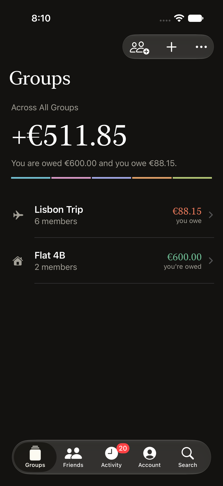
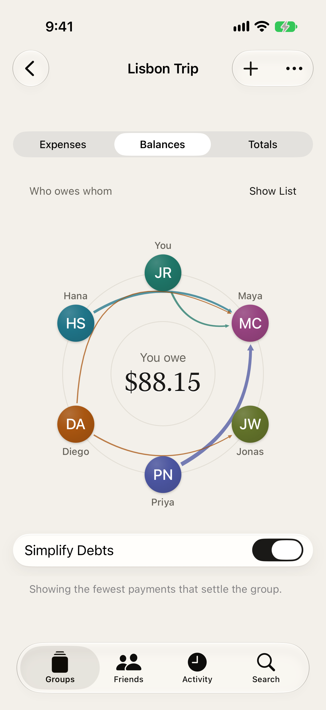
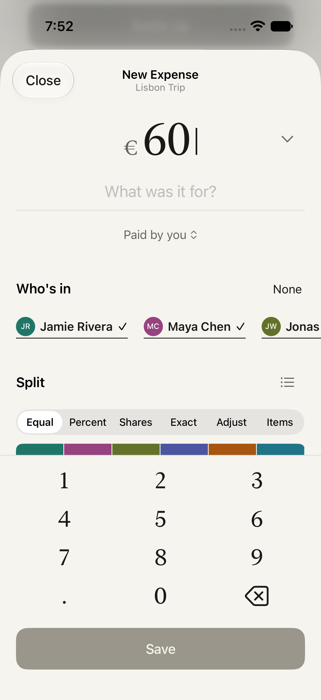
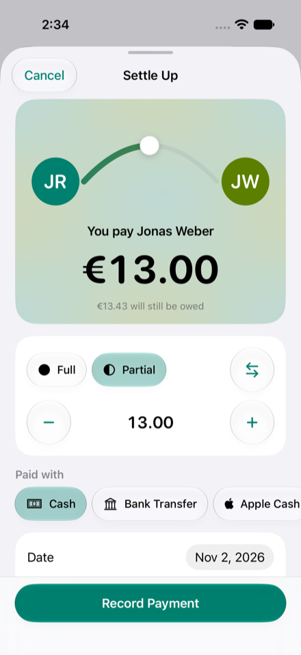

# Splt

Split costs with friends and groups on iPhone.

Splt is free forever. No ads, no accounts, no limits and no subscription. Your data stays on your device and in your own iCloud, and the smart features run on the device.

| | | | |
| --- | --- | --- | --- |
| {: width="180"} | {: width="180"} | {: width="180"} | {: width="180"} |
| Groups | Balance orbit | Split bar | Settle up |

## What you get

- Groups and one to one balances, with debts simplified to the fewest payments
- Equal, exact, percentage, share, adjustment and item splits, with a split bar you drag
- A balance orbit that shows who owes whom, and a settle up that closes the ring
- Any currency, with reference rates or a rate you set for the trip
- Quick add from a sentence or your voice, and receipt scanning. Receipt photos sync, and each person can pick their own items
- Group invites through iCloud, by link or by QR code
- Reminders you share as a message, and a balance link for friends without an iPhone
- A default split and a cover photo for each group
- Import from Splitwise, and export to a spreadsheet (CSV), PDF or JSON
- A trip recap for each group, and Spending charts for your share over the last 12 months
- Backup and restore of everything to a file
- A full edit history on each expense
- A light, dark or system appearance switch, large text, VoiceOver and Reduce Motion

## Links

- [Support and FAQ](support)
- [Privacy](privacy)
- [How sync works](sync)
- [Architecture](architecture)
- [Source code and issues on GitHub](https://github.com/harrypakhale98/Splt)

Splt is open source under the MIT license.
